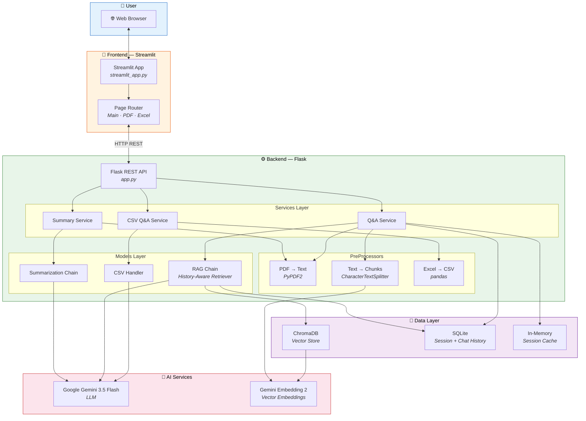
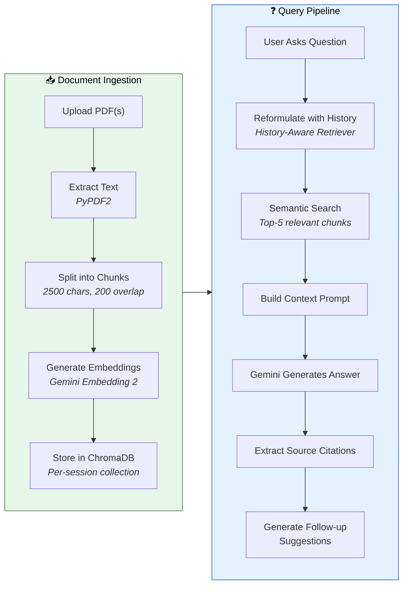
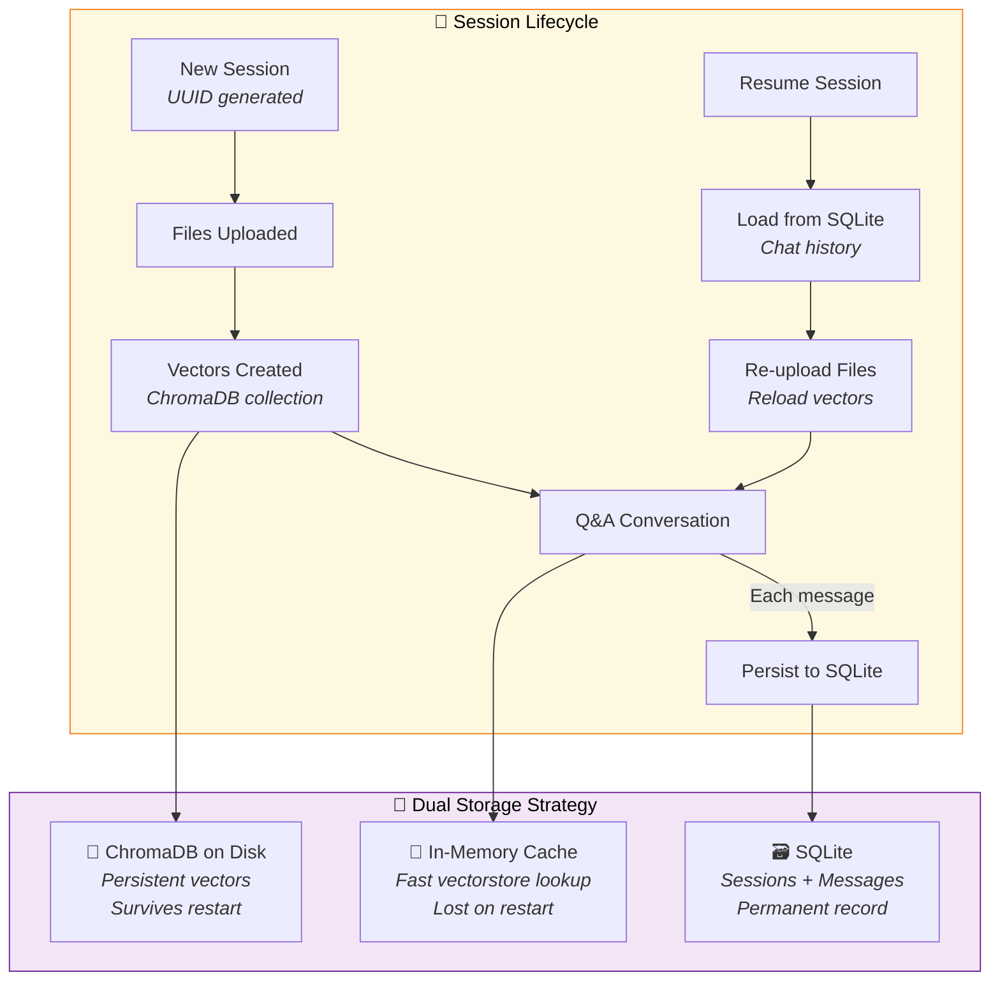
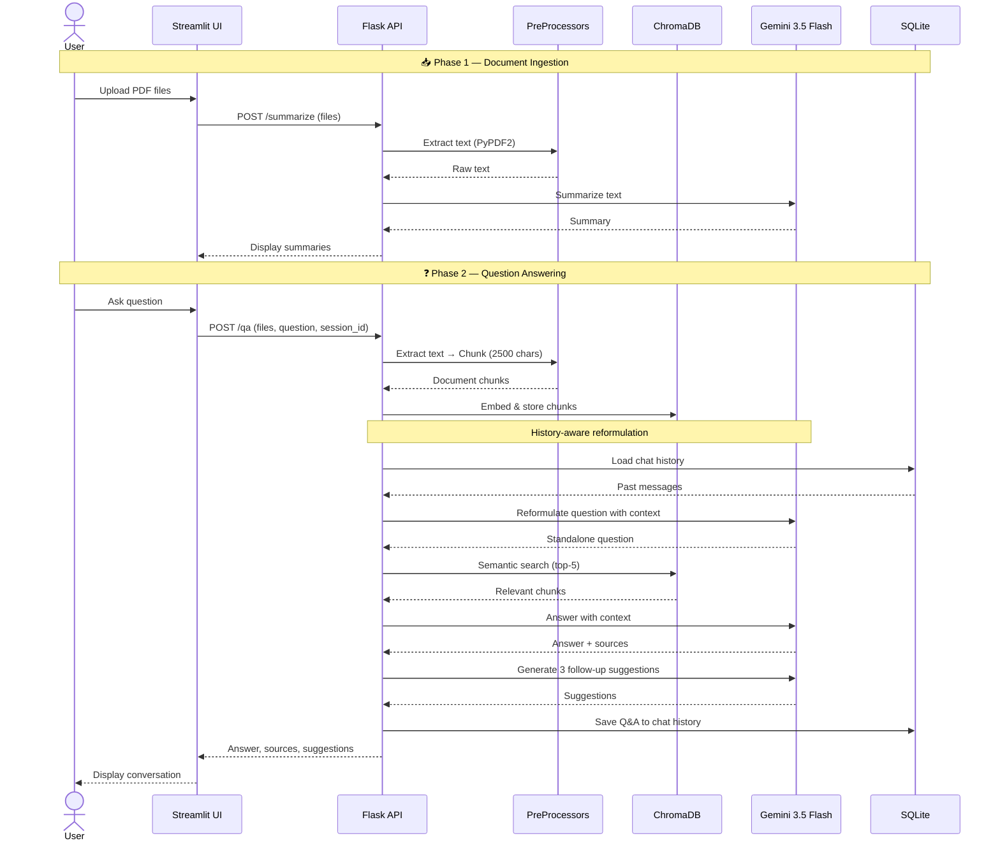

<div align="center">

# 📄 Know Your Doc

### *AI-Powered Document Intelligence — Summarize, Query & Understand Your Documents Instantly*

[](https://python.org)
[](https://flask.palletsprojects.com)
[](https://streamlit.io)
[](https://ai.google.dev)
[](https://langchain.com)
[](https://www.trychroma.com)

---

**Know Your Doc** is a full-stack RAG (Retrieval-Augmented Generation) application that lets you upload PDF and Excel documents, get instant AI-generated summaries, and have intelligent conversations with your documents using natural language. Built with Google Gemini, LangChain, ChromaDB, and Streamlit.

[Features](#-features) · [Architecture](#-architecture) · [Quick Start](#-quick-start) · [Screenshots](#-screenshots) · [Tech Stack](#-tech-stack) · [Project Structure](#-project-structure)

</div>

---

## ✨ Features

| Feature | Description |
|---------|-------------|
| 📑 **Multi-PDF Upload** | Upload one or multiple PDFs at once — no file limit |
| 🧠 **Auto-Summarization** | Instant AI summaries the moment files are uploaded |
| 💬 **Conversational Q&A** | Ask follow-up questions with full chat history awareness |
| 📎 **Source Citations** | Every answer cites which document(s) it came from |
| 💡 **Smart Follow-ups** | AI suggests 3 related questions after each answer |
| 📊 **Excel Processing** | Upload Excel files and query them with natural language |
| 🔄 **Session Persistence** | Resume past conversations even after server restarts |
| 🗂️ **Session Management** | Browse, resume, or start fresh sessions from the home page |

---

## 🏗 Architecture

### High-Level System Overview



### RAG Pipeline — Step by Step

This is the core intelligence of the app. When you ask a question about your documents, here's exactly what happens:



### Session & Persistence Architecture



---

## 📸 Screenshots

<details>
<summary><b>🏠 Home Page — Choose your workflow</b></summary>
<br/>


> The landing page lets you choose between **PDF** and **Excel** workflows, and shows past sessions you can resume.
</details>

<details>
<summary><b>📑 PDF Upload & Auto-Summary</b></summary>
<br/>

<br/><br/>


> Upload one or multiple PDFs — the app **automatically summarizes** each document the moment it's uploaded.
</details>

<details>
<summary><b>💬 Q&A Conversation with Citations</b></summary>
<br/>

<br/><br/>


> Ask questions across all your uploaded documents. Each answer comes with **source citations** and **AI-generated follow-up suggestions**.
</details>

<details>
<summary><b>📊 Excel Processing</b></summary>
<br/>

<br/><br/>


> Upload an Excel file and ask questions about the data in natural language.
</details>

<details>
<summary><b>🔄 Session Resume</b></summary>
<br/>


> All conversations are persisted. Come back anytime and resume where you left off.
</details>

---

## 🚀 Quick Start

### Prerequisites

- **Python 3.10+**
- **Google API Key** — Get one from [Google AI Studio](https://aistudio.google.com/apikey)

### 1. Clone the Repository

```bash
git clone https://github.com/Ishmeet04/Know-Your-Doc.git
cd Know-Your-Doc
```

### 2. Create & Activate Virtual Environment

```bash
python3 -m venv .venv
source .venv/bin/activate        # macOS / Linux
# .venv\Scripts\activate         # Windows
```

### 3. Install Dependencies

```bash
pip install -r backend/requirements.txt
```

### 4. Set Up Environment Variables

Create a `.env` file in the project root:

```env
GOOGLE_API_KEY=your_google_api_key_here
```

### 5. Start the Backend (Flask API)

```bash
python -m backend.app
```

The Flask server starts on **`http://localhost:5001`**

### 6. Start the Frontend (Streamlit UI)

In a new terminal:

```bash
streamlit run frontend/streamlit_app.py
```

The Streamlit app opens at **`http://localhost:8501`**

---

## 🛠 Tech Stack

| Layer | Technology | Purpose |
|-------|-----------|---------|
| **Frontend** | Streamlit | Interactive web UI with chat interface |
| **Backend** | Flask | REST API server |
| **LLM** | Google Gemini 3.5 Flash | Text generation, summarization, Q&A |
| **Embeddings** | Gemini Embedding 2 | Semantic vector embeddings |
| **RAG Framework** | LangChain | Chain orchestration, history-aware retrieval |
| **Vector Store** | ChromaDB | Persistent semantic search |
| **Database** | SQLite | Session management, chat history persistence |
| **PDF Parsing** | PyPDF2 | Text extraction from PDF documents |
| **Excel Parsing** | pandas + openpyxl | Spreadsheet reading and conversion |

---

## 📁 Project Structure

```
Know-Your-Doc/
│
├── 📄 .env                          # API keys (not committed)
├── 📄 .gitignore                    # Git exclusions
├── 📄 README.md                     # You are here!
├── 📄 requirements.txt             # Python dependencies
│
├── 🎨 frontend/
│   └── streamlit_app.py             # Streamlit UI — pages, chat, file upload
│
├── ⚙️ backend/
│   ├── app.py                       # Flask REST API — routes & entry point
│   │
│   ├── 🔧 PreProcessors/           # Document pre-processing
│   │   ├── pdf_to_text.py           #   PDF → raw text (PyPDF2)
│   │   ├── textToChunks.py          #   Text → LangChain Document chunks
│   │   └── xl2csv.py                #   Excel → CSV conversion (pandas)
│   │
│   ├── 🧠 models/                   # AI model chains
│   │   ├── qa_RAG.py                #   RAG chain + follow-up suggestion gen
│   │   ├── summarization_chain.py   #   Summarization prompt chain
│   │   └── csv_handle.py            #   Direct Gemini queries on CSV files
│   │
│   ├── 📡 services/                 # Business logic layer
│   │   ├── q_a.py                   #   Full Q&A orchestration
│   │   ├── summary_service.py       #   PDF summarization service
│   │   └── csv_qa.py                #   Excel → CSV → Gemini pipeline
│   │
│   ├── 💾 database/                 # Data persistence
│   │   ├── chroma_setup.py          #   ChromaDB vector store setup/load
│   │   ├── persistent_db.py         #   SQLite — sessions, chat history, LangChain adapter
│   │   ├── session_db.py            #   In-memory session cache
│   │   ├── chroma_store/            #   ChromaDB data files (gitignored)
│   │   └── sessions.db              #   SQLite database file (gitignored)
│   │
│   └── 🧪 testing/
│       └── list_collections.py      #   Debug utility for ChromaDB collections
│
├── 📸 assets/                       # Screenshots for README
│
└── 📂 database/
    └── files/                       # Temporary file storage for Excel processing
```

---

## 🔌 API Endpoints

| Method | Endpoint | Description | Body |
|--------|----------|-------------|------|
| `POST` | `/summarize` | Summarize one or more PDFs | `files`: multipart PDF(s) |
| `POST` | `/qa` | Ask a question across PDFs | `files`: PDFs, `question`: str, `session_id`: str |
| `POST` | `/process_excel` | Query an Excel file | `file`: Excel, `query`: str, `session_id`: str |
| `GET` | `/sessions` | List all past sessions | — |
| `GET` | `/history/<session_id>` | Get chat history for a session | — |

---

## 🧩 How the RAG Pipeline Works

Understanding the RAG (Retrieval-Augmented Generation) pipeline is key to understanding this project:



### Key Design Decisions

1. **History-Aware Retriever** — Before searching the vector store, the user's question is reformulated using chat history. This means follow-up questions like *"What about section 3?"* are understood in context.

2. **Per-Session Vector Collections** — Each session gets its own ChromaDB collection (`langchain_{session_id}`), so different document sets don't contaminate each other's search results.

3. **Dual Persistence** — In-memory cache for speed during active sessions + SQLite for permanent storage that survives server restarts.

4. **Source-Tagged Chunks** — Every text chunk carries its source filename in metadata, enabling precise citation back to the original document.

---

## 📝 Environment Variables

| Variable | Required | Description |
|----------|----------|-------------|
| `GOOGLE_API_KEY` | ✅ | Your Google AI API key for Gemini access |

---

## 🤝 Contributing

Contributions are welcome! Here's how:

1. **Fork** the repository
2. **Create** a feature branch: `git checkout -b feature/amazing-feature`
3. **Commit** your changes: `git commit -m 'Add amazing feature'`
4. **Push** to the branch: `git push origin feature/amazing-feature`
5. **Open** a Pull Request

---

<div align="center">

**Built with ❤️ by [Ishmeet Singh](https://github.com/Ishmeet04)**

*If this project helped you, give it a ⭐ on GitHub!*

</div>
